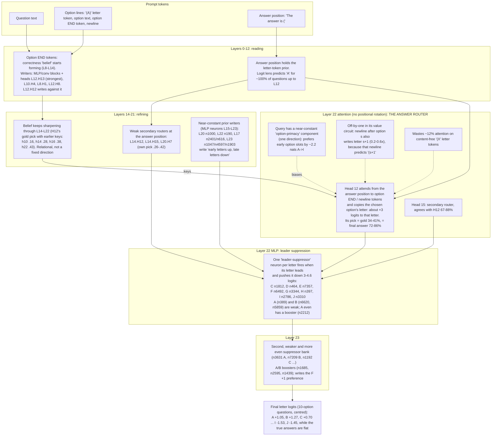
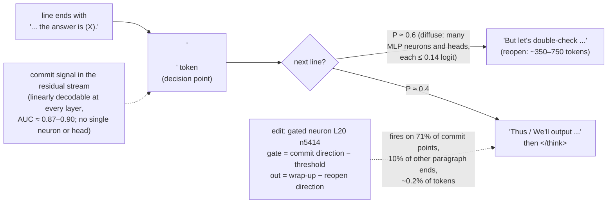
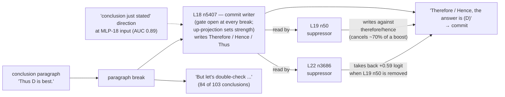

# How LFM3-1.7B answers a multiple-choice question (direct-answer mode)

A circuit map assembled from generations 1–3 of the weight-editing loop. Each finding names the editor and generation that found it (`g1 ed_a` = generation 1, editor ed_a) and how strong the evidence is.

- **Protocol:** MMLU-Pro, thinking disabled, assistant turn opened with "The answer is (". The answer is the option letter with the highest next-token logit.
- **Architecture recap:**
  - 24 layers of width 2,048;
  - 13 gated short-convolution layers;
  - 6 full-attention layers (2, 6, 10, 14, 18, 22) and 5 sliding-window attention layers (4, 8, 12, 16, 20; window 256), each with 16 query heads and 4 key/value heads of size 128;
  - a SwiGLU MLP (7,680 wide) in every layer, with sandwich RMSNorms;
  - tied input/output embedding.

## The pipeline at a glance

## Findings in detail

### 1. The answer is decided late, by one head
- **Logit lens** (residual stream at the answer position, through the final norm and the tied output layer, restricted to option letters; g1 claude, ed_b; g2 ed_b), option-letter accuracy by layer:

  | After layer | 8 | 12 | 16 | 20 | 22 | 24 |
  |---|---|---|---|---|---|---|
  | Accuracy | .13 | .12 | .21 | .26 | .29 | .38 |

  Up to L12 it predicts "A" for 510 of 512 questions: the plain token prior after " (".
- **L22.H12 is the answer router.**
  - Direct logit attribution: +3.1 logits to the correct letter on average (g1 claude, g1 ed_a, g1 ed_b independently).
  - It attends to the option END and newline tokens: 65% of its attention (g2 ed_b), or 42% on option text plus 45% on newlines (g3 ed_a).
  - Its attention argmax picks gold 34–41% of the time and agrees with the final answer 72–86% of the time.
  - The value it copies decodes to the right letter 97–99.6% of the time at every option length (g3 ed_b).
- **Layer 22 has no positional rotation.** Dot products of the recorded queries and keys reproduce its attention scores with 0.3% residual variance (g2 ed_a), so its QK circuit can be analysed exactly.
- **The query is about 93% a constant vector** (g3 ed_b). A constant query alone scores 34%; the question-specific part is worth about 5 points. Given the keys it sees, the query is close to optimal: strengthening the question part, adding a gold-minus-wrong direction, or removing anti-gold directions all failed to help.

### 2. The "belief" at the option tokens
- **Where it forms** (g2 ed_b): a correct-versus-incorrect signal forms at the option-end tokens between layers 8 and 14, mostly written by MLP and conv blocks. Separation by layer:

  | Layer | h4 | h8 | h10 | h12 | h14 |
  |---|---|---|---|---|---|
  | Separation | .02 | .25 | .81 | .89 | 1.00 |

- **Attention writers of the belief:** L12.H13 (strongest), L10.H4, L8.H1, L12.H8. L12.H12 writes against it (correlation −0.82).
- **The belief is relational, not a fixed feature** (g3 claude). A fixed correct-versus-incorrect direction picks gold only 16–22% of the time (chance 11.5%) at every layer from 7 to 15, while the model gets 34–38%. It keeps refining through L14–L22 (g3 ed_b).
- **On questions the model gets wrong, the belief is itself wrong.** Probes pick gold there at chance (g2 ed_b). This is the main limit on accuracy: a knowledge error, not a routing error.
- **L12.H13 sets confidence, not ranking** (g2 ed_b, g3 claude). Scaling its output changes entropy and the correct letter's log-probability with a clean dose-response, but not the option ranking:

  | L12.H13 output | Accuracy (hidden) | Log-prob of correct letter |
  |---|---|---|
  | ×0 | −1.25 / +1.25 in two different hidden sets | +0.50 / +0.51 |
  | ×0.5 | | +0.25 |

  The calibration effect also transfers to GPQA (+0.32 at ×0, +0.14 at ×0.5).

### 3. Letter-position bias: three mechanisms that stack
The model over-picks early letters. Predicted versus true counts on 512 DEV questions (g1 claude):

| | A | B | C | D | E | F | G | H | I | J |
|---|---|---|---|---|---|---|---|---|---|---|
| Predicted | 81 | 80 | 88 | 55 | 46 | 39 | 41 | 31 | 27 | 24 |
| True | 62 | 59 | 47 | 63 | 43 | 48 | 38 | 44 | 50 | 58 |

1. **Near-constant prior writers.** MLP neurons in L15–L23 fire on nearly every question and write a fixed "early up, late down" letter preference: L20 n1000, L22 n190, L17 n2401 and n616, L23 n1047, n4597 and n1903, among others (g1 ed_a, g1 ed_b, g3 ed_a).
2. **Uneven leader suppression in the L22 MLP** (g1 claude, confirmed by g1 ed_a and g2 ed_b).
   - One neuron per letter fires when that letter leads the stream entering the MLP and pushes it down.
   - Summed suppression of a leader, L22 and L23 together: A −1.2, B −2.2, C −4.2, D −4.1, E −5.4, F −4.6, G −5.3, H −5.6, I −5.4, J −5.3.
   - So an early-letter leader keeps its lead, while a late-letter leader is knocked down.
   - Overall the L22 MLP works against whatever attention retrieved (correlation −0.88): negative feedback that also damps overconfidence.
3. **Option-primacy in the queries** (g2 ed_a).
   - Option keys carry an ordinal slot signal along one direction (mean key value A −5.7, B −3.8 … J +0.3).
   - The answer-position query has a near-constant component along it (about 32% of its norm), so L22's heads prefer early option *slots* by about 2.2 nats from A to I.
   - It is the slot, not token distance (−0.15 per 100 tokens). L20 has the same mechanism, weaker.

Compensating effects:
- H12's own letter tilt partly counteracts the prior: A −.59, B −1.41, G +1.18.
- L23 writes an F +0.98 preference that nothing else explains (g3 ed_b).

**How much it costs.** Despite these large logit-level biases, removing them is worth little accuracy. A cross-fitted constant per-letter debias gains between +0.1 and +2 points depending on the question set (g1 all editors, g2 ed_b, g3 ed_b). Every bias-removal edit scored about 0 on hidden questions while improving the correct letter's log-probability by +0.1 to +0.2.

### 4. Smaller quirks
- **Off-by-one value write in L22.H12** (g3 ed_a). The newline after option s predicts "(s+1", and H12's value copies some of that, writing letter s+1 at 0.2–0.6× its diagonal. Its diagonal gains are uneven: A 16, B 10.5, G 31.5, H 30. An oracle fix is worth only about +0.5 points.
- **Content-free letter-token attention** (g3 ed_b). L22 heads spend 7–50% of their attention on the "(X" tokens, which come before the option text and so cannot carry its content (H12: 11.6%). Removing it: 0.00 on HOLDOUT.
- **Secondary routers** (g2 claude, g2 ed_b):

  | Head | Own pick = gold | Agrees with H12 |
  |---|---|---|
  | L22.H15 | .34–.40 | 67–88% |
  | L22.H14 | .40 | 81–88% |
  | L14.H12 | .26–.42 | 31–36% |
  | L14.H15 | .27 | 31–36% |
  | L20.H7 | .28 | 31–36% |

  Amplifying the weak routers does not help (hidden −1.6 to −1.8).
- **No long-prompt collapse** (g1 claude): within subjects, longer questions are *easier* (+7.8 points). The correctness signal does not weaken for late slots or beyond the 256-token sliding window (g3 ed_a).
- **Length bias:** the model picks the longest option 26% of the time; gold is the longest in 19% of questions. A cross-validated correction gains nothing (g2 ed_b).

### 5. Knowledge the answer pathway does not use
- Inside the multiple-choice prompt, each option text's likelihood is at chance for finding gold (g3 ed_a).
- **Out of context**, the likelihood of an option text as the answer to the bare question picks gold on about 19–25% of the questions the letter protocol gets wrong (chance about 12%; g2 ed_b, g3 ed_a).
- The model has some knowledge it only uses when it generates the answer itself. This is recorded as a future direction in `docs/IDEAS.md`.

## What the edits showed (causal evidence)

| Intervention | Mechanism hit | Accuracy on hidden questions | Calibration (log p correct) |
|---|---|---|---|
| Halve L22 late-letter suppressors (+ A/B boosters) | leader suppression | +0.5 | −0.14 to −0.17 |
| Remove letter readout of prior-writer neurons (12–27 neurons) | prior writers | −0.5 to −1.5 | +0.11 to +0.18 |
| Remove option-primacy query direction (L22, L20) | query primacy | −0.5 to −1.6 | +0.13 to +0.19 |
| Amplify weak routers ×1.5 / ×2 | secondary routers | −1.75 / −1.62 | −0.15 / −0.28 |
| Ablate or halve L12.H13 | belief confidence | −1.25 / −0.25 (and +1.25 in g2) | **+0.50 / +0.25** (transfers to GPQA) |
| Remove letter-token attention (L22) | "(X" attention | −0.5 / −1.0 | +0.01 / +0.03 |

**Overall picture.** In direct-answer mode the answer pathway is a clean but limited circuit. Mid-layer blocks build a relational belief at the option tokens. One head in L22 reads it out, a few biases tilt the letter, and a negative-feedback MLP calibrates the result. Every bias found is real and causal, but removing them moves probability between letters rather than adding correct answers. The errors are in the belief itself, which is to say in the model's knowledge.

---

# Thinking mode (phase 2): how LFM3-1.7B spends its thinking budget

Evidence: the 96-question trace bank (D33) and generation 4's analysis passes. The protocol is D30: 3,072-token cap, temperature 0.6.

## Behaviour

- **Running out of budget is the main failure.** 55% of answers hit the 3,072-token cap. 84% of finished answers are correct. The written answer after `</think>` costs about 245 tokens, so the thinking really has about 2,800.
- **Indecision, not computation.** Truncated and finished traces have the same density of arithmetic ("=") and of option-by-option mentions. Hedging words are 2–4× denser in truncated traces ("maybe", "perhaps", "Alternatively", "Hmm").
- **Post-commitment re-checking.** Every finished trace states an answer inside the thinking ("the answer is (X)") before closing.
  - After such a statement, the next line reopens the question ("But let's double-check ...") 31 times out of 58, and wraps up ("We'll output ...", "Thus ...") 20 times.
  - The re-check rarely changes the answer: 2 of 43 finished traces changed, a net gain of +1.
  - 17 truncated traces had stated an answer, and 9 of those statements were correct, before running out of budget while re-checking.

## Mechanism (generation 4, editor `claude`)

- **The parent predicts its own continuation well.** At the token after a statement line, next-token mass on reopening words is 0.81 where the trace reopened and 0.32 where it wrapped up.
- **The "reopen" push is distributed.** Direct logit attribution through the sandwich norms and the final norm finds no component that pushes reopening specifically after a commitment. The largest commit-specific contributions are under 0.14 logit each (L20.H8, L16.H15, L19 neuron 1851).
- **The "answer just stated" condition is distributed.**
  - No single MLP neuron detects it (best AUC 0.90, early-layer lexical features with small activations), and no attention head isolates it (attention to the statement span differs by at most 0.03).
  - It is linearly decodable from the residual stream at every layer: AUC about 0.9; cross-validated AUC 0.83–0.89 from MLP activations; head outputs separate by at most 3 sd (L22.H10).
  - At the input of MLP 20, a mean-difference direction scores commit points at +13.4, paragraph-end controls at −2.0, and all tokens at 0. Its 99.8th percentile is 10.3.
- **A conditional repair is possible without touching anything else.** The repair repurposes one quiet neuron (L20 n5414) as a gated detector: its gate reads the commit direction minus a threshold, and its output writes "wrap-up minus reopen".
  - At commit points, P(reopen) falls from 0.81 to 0.68 and P(wrap-up) rises from 0.11 to 0.24.
  - At ordinary paragraph ends, nothing changes.
  - Along finished traces, the per-token log-prob change is under 0.001 on average, and the only change above 0.5 is at a commit point.
  - Layers 21–23 dilute the edit to about ⅓ of its direct (read-out) effect.
  - Generation-level effects, measured on paired generations with the same seeds:
    - On fresh practice questions the edit turns cut traces that had committed into correct finished answers: +4 gained, 0 lost over the 64 holdout questions (+6.3 pp, SE about 3.0).
    - Finished traces end 300–1,400 tokens sooner with the same answer.
    - Traces that never state an answer are untouched. These are most of the cut traces, so this is the upper limit of this mechanism.

## A second, sparse commit circuit (generation 4, editor `ed_a`)

`ed_a` looked at a different decision point: the paragraph break after a **conclusion paragraph** ("Thus D is best."), before the formal "the answer is (X)". Here it found a *sparse* circuit, unlike the diffuse picture above:

- **L18 neuron 5407 is a commit writer.** Its output ranks Therefore, Hence and Thus at 9th, 12th and 14th of 128k tokens.
  - Its activation is −2.3 at commit points versus about −0.5 to −1.0 at re-check points and ordinary breaks.
  - It correlates −0.77 with the odds of committing.
- **Two downstream neurons suppress it.** L19 n50 and L22 n3686 read n5407's output and write against therefore/hence.
  - They form a layered self-correction: boosting n5407 alone is cancelled by about 70%.
  - Removing L19 n50 lets L22 n3686 take part of the boost back.
  - This is a concrete example of the "later layers dilute an edit" effect seen in phase 1 and above.
- **Behaviour change without accuracy change.**
  - The edit was: n5407's up-projection plus 0.6 × the conclusion direction, with both suppressors' outputs zeroed.
  - Commit probability at conclusion breaks went from 0.44 to 0.70, and post-conclusion re-checks fell by about 40%.
  - But accuracy on 64 fresh questions was +0.0 pp (SE 3.9). The newly finished traces were only 50–60% correct, and sampled traces diverge: three answers that originally finished just under the cap now hit it.
- **The cut traces that never conclude make up about 70% of the cut traces in `ed_a`'s DEV set.** They deliberate option by option, mostly in health, law and physics. Neither circuit touches them; they are the open problem for the next generation.

