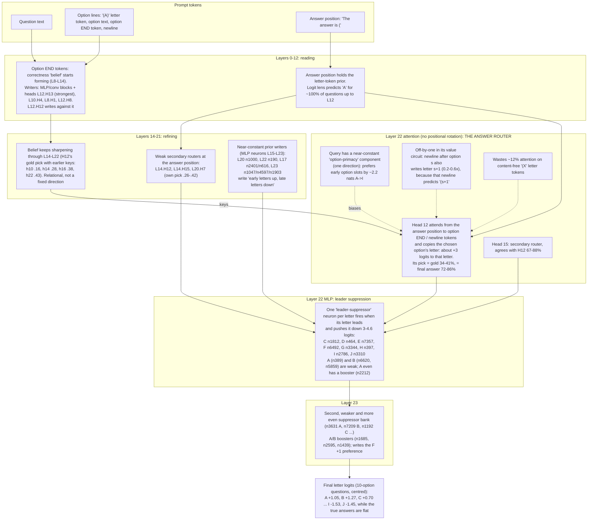
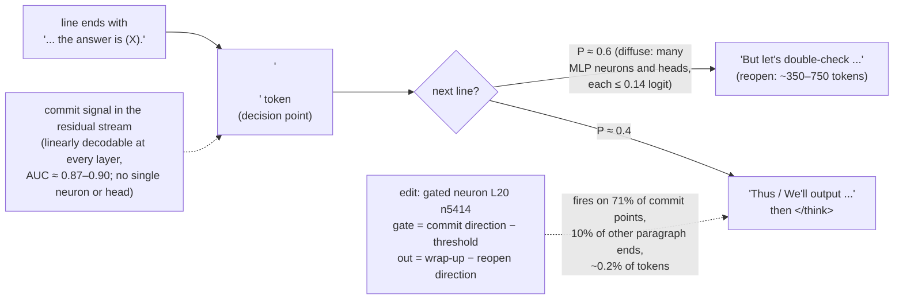
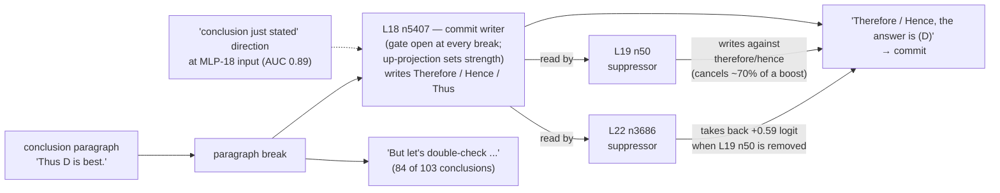
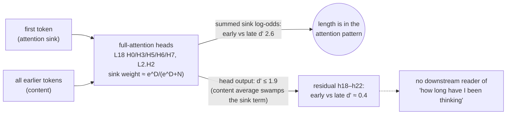
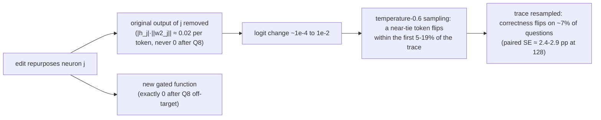
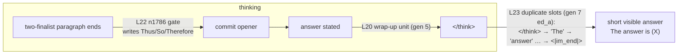
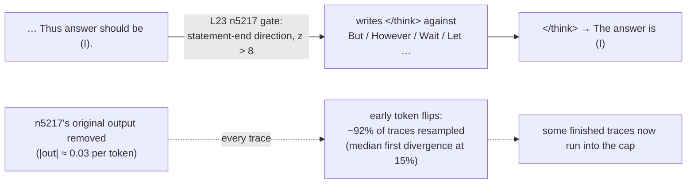

# How LFM3-1.7B answers a multiple-choice question (direct-answer mode)

A circuit map assembled from generations 1–3 of the weight-editing loop. Each finding names the editor and generation that found it (`g1 ed_a` = generation 1, editor ed_a) and how strong the evidence is.

- **Protocol:** MMLU-Pro, thinking disabled, assistant turn opened with "The answer is (". The answer is the option letter with the highest next-token logit.
- **Architecture recap:**
  - 24 layers of width 2,048;
  - 13 gated short-convolution layers;
  - 6 full-attention layers (2, 6, 10, 14, 18, 22) and 5 sliding-window attention layers (4, 8, 12, 16, 20; window 256), each with 16 query heads and 4 key/value heads of size 128;
  - a SwiGLU MLP (7,680 wide) in every layer, with sandwich RMSNorms;
  - tied input/output embedding.

## The pipeline at a glance

## Findings in detail

### 1. The answer is decided late, by one head
- **Logit lens** (residual stream at the answer position, through the final norm and the tied output layer, restricted to option letters; g1 claude, ed_b; g2 ed_b), option-letter accuracy by layer:

  | After layer | 8 | 12 | 16 | 20 | 22 | 24 |
  |---|---|---|---|---|---|---|
  | Accuracy | .13 | .12 | .21 | .26 | .29 | .38 |

  Up to L12 it predicts "A" for 510 of 512 questions: the plain token prior after " (".
- **L22.H12 is the answer router.**
  - Direct logit attribution: +3.1 logits to the correct letter on average (g1 claude, g1 ed_a, g1 ed_b independently).
  - It attends to the option END and newline tokens: 65% of its attention (g2 ed_b), or 42% on option text plus 45% on newlines (g3 ed_a).
  - Its attention argmax picks gold 34–41% of the time and agrees with the final answer 72–86% of the time.
  - The value it copies decodes to the right letter 97–99.6% of the time at every option length (g3 ed_b).
- **Layer 22 has no positional rotation.** Dot products of the recorded queries and keys reproduce its attention scores with 0.3% residual variance (g2 ed_a), so its QK circuit can be analysed exactly.
- **The query is about 93% a constant vector** (g3 ed_b). A constant query alone scores 34%; the question-specific part is worth about 5 points. Given the keys it sees, the query is close to optimal: strengthening the question part, adding a gold-minus-wrong direction, or removing anti-gold directions all failed to help.

### 2. The "belief" at the option tokens
- **Where it forms** (g2 ed_b): a correct-versus-incorrect signal forms at the option-end tokens between layers 8 and 14, mostly written by MLP and conv blocks. Separation by layer:

  | Layer | h4 | h8 | h10 | h12 | h14 |
  |---|---|---|---|---|---|
  | Separation | .02 | .25 | .81 | .89 | 1.00 |

- **Attention writers of the belief:** L12.H13 (strongest), L10.H4, L8.H1, L12.H8. L12.H12 writes against it (correlation −0.82).
- **The belief is relational, not a fixed feature** (g3 claude). A fixed correct-versus-incorrect direction picks gold only 16–22% of the time (chance 11.5%) at every layer from 7 to 15, while the model gets 34–38%. It keeps refining through L14–L22 (g3 ed_b).
- **On questions the model gets wrong, the belief is itself wrong.** Probes pick gold there at chance (g2 ed_b). This is the main limit on accuracy: a knowledge error, not a routing error.
- **L12.H13 sets confidence, not ranking** (g2 ed_b, g3 claude). Scaling its output changes entropy and the correct letter's log-probability with a clean dose-response, but not the option ranking:

  | L12.H13 output | Accuracy (hidden) | Log-prob of correct letter |
  |---|---|---|
  | ×0 | −1.25 / +1.25 in two different hidden sets | +0.50 / +0.51 |
  | ×0.5 | | +0.25 |

  The calibration effect also transfers to GPQA (+0.32 at ×0, +0.14 at ×0.5).

### 3. Letter-position bias: three mechanisms that stack
The model over-picks early letters. Predicted versus true counts on 512 DEV questions (g1 claude):

| | A | B | C | D | E | F | G | H | I | J |
|---|---|---|---|---|---|---|---|---|---|---|
| Predicted | 81 | 80 | 88 | 55 | 46 | 39 | 41 | 31 | 27 | 24 |
| True | 62 | 59 | 47 | 63 | 43 | 48 | 38 | 44 | 50 | 58 |

1. **Near-constant prior writers.** MLP neurons in L15–L23 fire on nearly every question and write a fixed "early up, late down" letter preference: L20 n1000, L22 n190, L17 n2401 and n616, L23 n1047, n4597 and n1903, among others (g1 ed_a, g1 ed_b, g3 ed_a).
2. **Uneven leader suppression in the L22 MLP** (g1 claude, confirmed by g1 ed_a and g2 ed_b).
   - One neuron per letter fires when that letter leads the stream entering the MLP and pushes it down.
   - Summed suppression of a leader, L22 and L23 together: A −1.2, B −2.2, C −4.2, D −4.1, E −5.4, F −4.6, G −5.3, H −5.6, I −5.4, J −5.3.
   - So an early-letter leader keeps its lead, while a late-letter leader is knocked down.
   - Overall the L22 MLP works against whatever attention retrieved (correlation −0.88): negative feedback that also damps overconfidence.
3. **Option-primacy in the queries** (g2 ed_a).
   - Option keys carry an ordinal slot signal along one direction (mean key value A −5.7, B −3.8 … J +0.3).
   - The answer-position query has a near-constant component along it (about 32% of its norm), so L22's heads prefer early option *slots* by about 2.2 nats from A to I.
   - It is the slot, not token distance (−0.15 per 100 tokens). L20 has the same mechanism, weaker.

Compensating effects:
- H12's own letter tilt partly counteracts the prior: A −.59, B −1.41, G +1.18.
- L23 writes an F +0.98 preference that nothing else explains (g3 ed_b).

**How much it costs.** Despite these large logit-level biases, removing them is worth little accuracy. A cross-fitted constant per-letter debias gains between +0.1 and +2 points depending on the question set (g1 all editors, g2 ed_b, g3 ed_b). Every bias-removal edit scored about 0 on hidden questions while improving the correct letter's log-probability by +0.1 to +0.2.

### 4. Smaller quirks
- **Off-by-one value write in L22.H12** (g3 ed_a). The newline after option s predicts "(s+1", and H12's value copies some of that, writing letter s+1 at 0.2–0.6× its diagonal. Its diagonal gains are uneven: A 16, B 10.5, G 31.5, H 30. An oracle fix is worth only about +0.5 points.
- **Content-free letter-token attention** (g3 ed_b). L22 heads spend 7–50% of their attention on the "(X" tokens, which come before the option text and so cannot carry its content (H12: 11.6%). Removing it: 0.00 on HOLDOUT.
- **Secondary routers** (g2 claude, g2 ed_b):

  | Head | Own pick = gold | Agrees with H12 |
  |---|---|---|
  | L22.H15 | .34–.40 | 67–88% |
  | L22.H14 | .40 | 81–88% |
  | L14.H12 | .26–.42 | 31–36% |
  | L14.H15 | .27 | 31–36% |
  | L20.H7 | .28 | 31–36% |

  Amplifying the weak routers does not help (hidden −1.6 to −1.8).
- **No long-prompt collapse** (g1 claude): within subjects, longer questions are *easier* (+7.8 points). The correctness signal does not weaken for late slots or beyond the 256-token sliding window (g3 ed_a).
- **Length bias:** the model picks the longest option 26% of the time; gold is the longest in 19% of questions. A cross-validated correction gains nothing (g2 ed_b).

### 5. Knowledge the answer pathway does not use
- Inside the multiple-choice prompt, each option text's likelihood is at chance for finding gold (g3 ed_a).
- **Out of context**, the likelihood of an option text as the answer to the bare question picks gold on about 19–25% of the questions the letter protocol gets wrong (chance about 12%; g2 ed_b, g3 ed_a).
- The model has some knowledge it only uses when it generates the answer itself. This is recorded as a future direction in `docs/IDEAS.md`.

## What the edits showed (causal evidence)

| Intervention | Mechanism hit | Accuracy on hidden questions | Calibration (log p correct) |
|---|---|---|---|
| Halve L22 late-letter suppressors (+ A/B boosters) | leader suppression | +0.5 | −0.14 to −0.17 |
| Remove letter readout of prior-writer neurons (12–27 neurons) | prior writers | −0.5 to −1.5 | +0.11 to +0.18 |
| Remove option-primacy query direction (L22, L20) | query primacy | −0.5 to −1.6 | +0.13 to +0.19 |
| Amplify weak routers ×1.5 / ×2 | secondary routers | −1.75 / −1.62 | −0.15 / −0.28 |
| Ablate or halve L12.H13 | belief confidence | −1.25 / −0.25 (and +1.25 in g2) | **+0.50 / +0.25** (transfers to GPQA) |
| Remove letter-token attention (L22) | "(X" attention | −0.5 / −1.0 | +0.01 / +0.03 |

**Overall picture.** In direct-answer mode the answer pathway is a clean but limited circuit. Mid-layer blocks build a relational belief at the option tokens. One head in L22 reads it out, a few biases tilt the letter, and a negative-feedback MLP calibrates the result. Every bias found is real and causal, but removing them moves probability between letters rather than adding correct answers. The errors are in the belief itself, which is to say in the model's knowledge.

---

# Thinking mode (phase 2): how LFM3-1.7B spends its thinking budget

Evidence: the 96-question trace bank (D33) and generation 4's analysis passes. The protocol is D30: 3,072-token cap, temperature 0.6.

## Behaviour

- **Running out of budget is the main failure.** 55% of answers hit the 3,072-token cap. 84% of finished answers are correct. The written answer after `</think>` costs about 245 tokens, so the thinking really has about 2,800.
- **Indecision, not computation.** Truncated and finished traces have the same density of arithmetic ("=") and of option-by-option mentions. Hedging words are 2–4× denser in truncated traces ("maybe", "perhaps", "Alternatively", "Hmm").
- **Post-commitment re-checking.** Every finished trace states an answer inside the thinking ("the answer is (X)") before closing.
  - After such a statement, the next line reopens the question ("But let's double-check ...") 31 times out of 58, and wraps up ("We'll output ...", "Thus ...") 20 times.
  - The re-check rarely changes the answer: 2 of 43 finished traces changed, a net gain of +1.
  - 17 truncated traces had stated an answer, and 9 of those statements were correct, before running out of budget while re-checking.

## Mechanism (generation 4, editor `claude`)

- **The parent predicts its own continuation well.** At the token after a statement line, next-token mass on reopening words is 0.81 where the trace reopened and 0.32 where it wrapped up.
- **The "reopen" push is distributed.** Direct logit attribution through the sandwich norms and the final norm finds no component that pushes reopening specifically after a commitment. The largest commit-specific contributions are under 0.14 logit each (L20.H8, L16.H15, L19 neuron 1851).
- **The "answer just stated" condition is distributed.**
  - No single MLP neuron detects it (best AUC 0.90, early-layer lexical features with small activations), and no attention head isolates it (attention to the statement span differs by at most 0.03).
  - It is linearly decodable from the residual stream at every layer: AUC about 0.9; cross-validated AUC 0.83–0.89 from MLP activations; head outputs separate by at most 3 sd (L22.H10).
  - At the input of MLP 20, a mean-difference direction scores commit points at +13.4, paragraph-end controls at −2.0, and all tokens at 0. Its 99.8th percentile is 10.3.
- **A conditional repair is possible without touching anything else.** The repair repurposes one quiet neuron (L20 n5414) as a gated detector: its gate reads the commit direction minus a threshold, and its output writes "wrap-up minus reopen".
  - At commit points, P(reopen) falls from 0.81 to 0.68 and P(wrap-up) rises from 0.11 to 0.24.
  - At ordinary paragraph ends, nothing changes.
  - Along finished traces, the per-token log-prob change is under 0.001 on average, and the only change above 0.5 is at a commit point.
  - Layers 21–23 dilute the edit to about ⅓ of its direct (read-out) effect.
  - Generation-level effects, measured on paired generations with the same seeds:
    - On fresh practice questions the edit turns cut traces that had committed into correct finished answers: +4 gained, 0 lost over the 64 holdout questions (+6.3 pp, SE about 3.0).
    - Finished traces end 300–1,400 tokens sooner with the same answer.
    - Traces that never state an answer are untouched. These are most of the cut traces, so this is the upper limit of this mechanism.
  - **Confirmed under the deterministic engine (generation 5 selection, 128 hidden questions, paired):** +9.4 pp (z 3.6), 12 answers gained and none lost; cut share −11 pp. A stronger write (−15) gains less (+6.25, +12/−4), so the useful strength is near −9. This edit became the loop's first champion.
  - **Held out (128 untouched MMLU-Pro questions, thinking mode):** +7.0 pp (SE 2.5, z 2.8), +10/−1. 9 of the 10 gains are traces the unedited model cuts at the cap and the edited model finishes correctly, so the neuron works by letting already-correct reasoning conclude.
  - **Transfer to GPQA Diamond (198 questions, thinking mode, never used for tuning):** 12.6% → 16.7%, +4.0 pp (SE 2.1, z 1.9), +13/−5. The edit cuts fewer traces at the cap (168 → 158 of 198) and accuracy on finished traces stays the same (0.83 → 0.83). The direction matches MMLU-Pro, but the gain is not significant. GPQA almost never finishes within 3,072 tokens, so cut answers (scored wrong) pull both models below the 25% chance level.

## A second, sparse commit circuit (generation 4, editor `ed_a`)

`ed_a` looked at a different decision point: the paragraph break after a **conclusion paragraph** ("Thus D is best."), before the formal "the answer is (X)". Here it found a *sparse* circuit, unlike the diffuse picture above:

- **L18 neuron 5407 is a commit writer.** Its output ranks Therefore, Hence and Thus at 9th, 12th and 14th of 128k tokens.
  - Its activation is −2.3 at commit points versus about −0.5 to −1.0 at re-check points and ordinary breaks.
  - It correlates −0.77 with the odds of committing.
- **Two downstream neurons suppress it.** L19 n50 and L22 n3686 read n5407's output and write against therefore/hence.
  - They form a layered self-correction: boosting n5407 alone is cancelled by about 70%.
  - Removing L19 n50 lets L22 n3686 take part of the boost back.
  - This is a concrete example of the "later layers dilute an edit" effect seen in phase 1 and above.
- **Behaviour change without accuracy change.**
  - The edit was: n5407's up-projection plus 0.6 × the conclusion direction, with both suppressors' outputs zeroed.
  - Commit probability at conclusion breaks went from 0.44 to 0.70, and post-conclusion re-checks fell by about 40%.
  - But accuracy on 64 fresh questions was +0.0 pp (SE 3.9). The newly finished traces were only 50–60% correct, and sampled traces diverge: three answers that originally finished just under the cap now hit it.
- **The cut traces that never conclude make up about 70% of the cut traces in `ed_a`'s DEV set.** They deliberate option by option, mostly in health, law and physics. Neither circuit touches them; they are the open problem for the next generation.

## The never-concluding traces, and how the model tracks length (generation 5, editor `claude`)

### What the model believes mid-trace when it never concludes
- Method: each of 52 cut traces in the `det1` bank was interrupted at the paragraph break before 30% and 65% of its length, followed by "So the answer is (", and the letter distribution was read.
- **The forced belief is mostly wrong and over-confident.**
  - Traces that never state an answer: the argmax is correct 19% of the time at 30% and 26% at 65% (chance is 10%), with a mean confidence of 0.8.
  - Traces that do state one: 22% at 30% and 44% at 65%.
- **Calibration.** Confidence between 0.4 and 0.95 is near chance (10–19% correct). Only confidence ≥ 0.95 means something (41% correct, n 39).
- **The belief drifts.** The forced answer is the same at 30% and 65% in only 25 of 52 traces.
- **Reading.** These traces are mostly *not* "knows the answer but will not commit". They are cases where the reasoning has not converged. A confidence-gated commit cannot rescue them, so the target has to be the reasoning itself.

### Length is visible to attention, not to the residual stream

- **A difference-of-means "late versus mid" direction at paragraph breaks** (14 traces, layers 14 and 20) does rise with position.
  - Held-out, it fires only near the end of *finished* traces, never in cut traces. So it reads "wrapping up" content, not length.
  - Refit on cut traces alone, it saturates by about 1,500 tokens.
- **Sink dilution.** Several full-attention heads put 5–26% of their attention on the first token. That share falls smoothly with absolute length, with a log-odds slope of 0.6–0.85 against log N.
  - Summed over six heads, it separates ≤1,300 from ≥2,300 generated tokens with held-out d' 2.6 (oracle log N: 4.6).
  - But the heads' outputs mix that term with the average of the content values. In the residual stream the separation drops to d' ≈ 0.4.
- **Consequence.** Within this analysis, the network has no usable internal "budget is running out" signal, so it cannot plan for the cap. That is consistent with traces running into the cap mid-sentence.
  - An edit could build such a counter (re-read a sink head's value through a new o_proj direction).
  - A length-triggered stop, however, is out of scope for this experiment ("ends the thinking regardless of the problem"), so it was not pursued.

## Generation 6: two-finalist oscillation, answer re-derivation, and why small edits do not survive selection

### Oscillating between two finalists (editor `claude`)
- 18 of the parent's 53 cut bank traces narrow the choice to two options ("either F or G", "between C and H"), on average 58% into the trace. They then spend ~1,300 tokens re-sweeping without deciding. Finished traces rarely narrow (4 of 43).
- A forced answer right after the first two-finalist paragraph is correct in 8 of 18 such cut traces (7 of 11 when gold is one of the two; P(the pair) 0.99). At the cap it is 10 of 18. So the model has usually already found the right finalist; it does not commit.
- **The state is linearly readable** at the L21 MLP input. At paragraph-break tokens (any token containing "\n\n", 296 token types), a mean-difference direction separates breaks ending a two-finalist paragraph from all other breaks with leave-one-trace-out AUC 0.86.
- A gated neuron on that direction, writing commit openers (So/Thus/Therefore/Hence) minus deliberation openers, collapses the next-paragraph deliberation opener where it fires ("Option" 0.80 → 0.04, "Let" 0.61 → 0.13). In generations, commit openers after two-finalist paragraphs rose from 5/59 to 11/37.
- On selection (128 hidden) it made no net difference (+13/−13); see the noise finding below.

### The visible answer re-derives the whole solution (editor `ed_a`)
- After `</think>` the parent writes a ~250-token step-by-step re-derivation before "The answer is (X)". In 42 of 43 finished traces this answer equals the thinking's last answer.
- When the thinking ends late, this redundant text is what the cap cuts (5 of 53 cut bank traces; 4 had the right answer settled).
- Three L23 neurons, each firing at one position (`</think>` → `"The`, answer-initial `"The` → ` answer`, after `"The answer is (X)".` → end), make the answer exactly `"The answer is (X)"`. The letter is copied from the thinking with P = 1.00.
- On selection it saved 180 tokens per question but gained only +0.8 pp (+9/−8). Few selection traces are cut inside the answer.

### Resampling noise dominates paired selection of small edits
- Repurposing any neuron removes its original output, which nudges every logit a little. Under temperature-0.6 sampling a different token is soon drawn and the trace takes another path, even though the edit's gate never fired.
- Median first divergence from the parent's trace: 7% of the trace (`claude`, L21), 14% (`ed_a`, L23 ×3), 22% (carried L23 edit). Only 3-16 of 128 thinking traces stayed identical.
- The swaps follow the finish/cut boundary: a resampled finished trace sometimes runs to the cap (loss), and a resampled cut trace sometimes finishes (gain). This yields 11-26 swaps per edit and SE 2.6-4.0 pp on 128 questions, regardless of what the edit targets.
- Consequence: a mechanism whose true effect is +2 to +4 pp (a cue that occurs in 5-15% of questions) cannot pass z ≥ 2 on 128 questions. Editors' 32-question holdouts also overstate effects: +3 to +6 there vs ±0.8 on selection.

## Generation 7: why an edit cannot be silent, sink tokens, and duplicate neurons

- **No neuron is free after Q8_0** (both editors, independently).
  - llama.cpp quantises the MLP activation vector to Q8_0 in blocks of 32 before w2. A neuron contributes exactly 0 only where |h_j| < (block maximum)/254.
  - In L12–L23 even the quietest neuron is nonzero on 30–80% of tokens; the median neuron on 92–95%.
  - No w2 column quantises to all zeros.
- **Divergence comes from what is removed, not from what is added.**
  - `claude`'s L22 n1786 gate is exactly silent before the first diverging token in 31 of 32 traces.
  - Removing n1786's original output, about 0.02 per token and the second-quietest in L12–L23, still diverges 95 of 96 traces, at a median 5.6% into the trace.
  - `ed_a` freed slots by merging near-duplicate neurons, which changes the output by only 2.6e-4. Traces still diverged at 13–19%, with 2–6 of 32 identical.
- **Near-duplicate neurons in L23** (`ed_a`):
  - {1228, 3401, 3793, 6986}: w1/w3/w2 cos ≥ 0.9998, activation correlation 0.9999;
  - {331, 5105, 881}: 0.9995;
  - {5821, 2400}: 0.997.
  - Merging one into its twin (`w2_k += s·w2_j`) frees the slot algebraically.
- **Prompt-sink tokens break bias-proxy gates** (`claude`).
  - The first prompt tokens (BOS, `<|im_start|>`, `user`, `\n`) have low norm and the same activation in every text.
  - A gate whose threshold comes from the mean-input direction fires on them at L22/L23. That would change every question through the KV cache.
  - Projecting the gate off their 4-dim subspace fixes it.
- **The only exactly silent carrier is out of scope.**
  - Sampling applies top-k 20 first, so a token's logit matters only while it ranks in the top 20.
  - The tied embedding row of a never-used token would therefore be an exactly silent linear gate. `model.embed_tokens` may not be edited.
- **The mechanisms work where they fire, but their events are rare.**
  - Two-finalist commit: a commit opener after a two-finalist paragraph 10/29 vs the parent's 3/39 (gen 6: 11/37 vs 5/59). Accuracy +1.0 pp (SE 2.8) on 96 paired bank questions.
  - Short visible answer: 32 of 33 finished DEV answers become exactly "The answer is (X)" with the parent's letter. It rescues traces that close the thinking late and are cut inside the answer (4 of 4 on DEV; 1 of 5 in selection).
  - In selection: +3.1 pp, z 1.08.

## Generation 8: commit points in long traces, and a stack that passes

### Where the model fails to commit
Cut traces (cut at 3,072 tokens, scoring 0) pass through several points where a finished trace would commit. In cut traces the model keeps deliberating instead:

| commit point | what the parent does next | evidence |
|---|---|---|
| two finalists stated ("so the answer is B or D") | the next paragraph opens with "Thus"/"So", then " we" (P 0.36), " let", " which", " maybe"; " I"/" answer" only 0.10 | `claude`, L23 MLP input: the state "Thus after two finalists" is separable from other paragraph openers (LOTO AUC 0.963) |
| end of a full pass through the options (a "sweep end") | "Thus" .33, "We" .26, "Given" .08, "Hence" .006 | `ed_a`, L23 MLP input: AUC 0.968. Cut traces sweep 2.9× on average, finished ones 1.3× |
| the thinking is closed but the visible answer re-derives everything | the answer gets cut | gen 7 `ed_a`; now part of the champion |

- **A forced commit is often right.** Forced "Hence, the answer is (" at a sweep end is right in 36–47% of cut traces, which score 0 now. In finished traces it costs ~1 in 25.
- **No counting of sweeps.** A gate for "start of a 2nd sweep" separates it from other breaks (AUC 0.89) but not from 1st-sweep starts (0.64). The L23 residual stream encodes "a sweep begins", not how many have happened.
- **A connective word alone is not a commit.** Paragraphs that open with "Hence" state an answer 79% of the time in the parent. Of the "Hence" paragraphs the edit inserted, only 46% did ("Hence we need …" continues deliberating). The commit is decided after the connective, by the next one or two tokens.

### The current champion (generation 8): three gated units on top of the base

- Selection: +5.47 pp vs the gen-5 champion (z 2.38, +8/−1). Cut share 47.7 → 40.6%.
- **The gains add up.** Alone, the L22 gate gave +1.0 on the bank and the L23 short answer +3.1 (z 1.08) in gen-7 selection. Stacked, they pass.
- **Held out (128 untouched MMLU-Pro questions, thinking):** +11.7 pp vs base (z 3.8, +16/−1); +4.7 vs the gen-5 champion (z 1.34).
- **Transfer to GPQA Diamond (198, thinking):** 12.6% → 19.2%, +6.6 pp vs base (SE 2.0, z 3.2, +15/−2), cut answers 168 → 150. vs the gen-5 champion: +2.5 (z 1.1). The gain over base now transfers significantly to a benchmark never used for tuning.

### What did not transfer
- `claude`'s L23 n881 unit turns "Thus" after two finalists into "Thus I'll go with (X)" (P 0.10 → 0.78 teacher-forced). Off-target change: mean |dlogp| 0.0002 per token.
  - On bank questions not used for the fit: +8.3 pp over the stack.
  - On the 128 selection questions: −0.8.
  - Only 23 of 128 selection traces reach a two-finalist statement. Every edit resamples the other traces, so a mechanism that rare cannot be seen at n = 128.
- **Bank gains are a screen, not a measurement.** Gains on the 96-question bank, even out of sample for the fit, came in ~2.5 SE above selection. The bank questions were looked at many times across generations.

## Generation 9: closing at a stated answer works, but resampling pays it back

### Where cut traces spend their budget (`claude`, code/005, 96 bank traces)

| | cut traces | finished traces |
|---|---|---|
| paragraphs per trace | 49 | 28 |
| churn openers per trace ("Alternatively", "Maybe", "Wait", "Actually", …) | 2.6 | 0.4 |
| P(churn opener \| previous paragraph ends uncertain) | 0.12 | 0.04 |
| firm single-letter conclusion, then reopened | 8 of 47 (5 right) | — |

- **The first firm conclusion is almost always the final answer.** In finished traces it matches in 38 of 39. Reopening after one is pure cost in finished traces, and a cut trace loses an answer it already had.
- **The gen-5 L20 wrap-up gate (n5414) fires late.**
  - At the end of a single-letter statement that ends its line, its gate is high (z +11 to +14; hedged +5 to +7). Yet at the next newline the parent still reopens with P 0.45–0.65 ("But", "However", "Let's double-check").
  - Statements that do not end their line leave the gate low (z −8 to −14).
- **The statement end is a sharp state.** The last token of an in-thinking single-letter statement ("… answer is (E).", "I'll go with J.") separates from every other token at the L20 MLP input with a leave-one-text-out AUC of 0.988. It also separates from option-sweep letters, two-letter statements ("B or H?"), the prompt's own "The answer is (X)" instruction, and the visible answer.

### The unit and what it does (`claude`, L23 n5217)

- **Linear read-out** (recorded activations): P(</think>) at statement ends goes from a median of 0.000 to 0.999. The unit fires on 72% of them and moves no prompt, two-letter or post-think token.
- **Measured outcome:** the same pattern on all three measurement sets.

| set | cut → closed (right) | finished → cut (were right) | net |
|---|---|---|---|
| holdout bank 96 | 11 (7) | 7 (5) | +2.1 (SE 3.9) |
| selection 128 | 6 (4) | 6 (5) | −0.8 (SE 2.4) |

- **The mechanism and the noise are about the same size.** About 60% of rescued cut traces are right. About 5% of finished traces get resampled into the cap, and most of those were right.
- **`ed_a`'s "Hence answer" sweep-end commit fails the same way.**
  - Selection: 5 rescued, 2 of them right; 7 newly cut, 5 of those were right. −2.3 pp (SE 2.1).
  - It also exposed a separate limit: forced to "Hence answer", the model hedges ("likely either F or J") and keeps deliberating.

### Lessons
- **The holdout bank (D57) predicted selection; the main bank did not.**

| candidate | main bank | holdout bank | selection |
|---|---|---|---|
| `claude` | +8.3 | +2.1 | −0.8 |
| `ed_a` | +4.2 | −2.1 | −2.3 |

  Bank gains are a screen only. Fitting directions on bank texts and looking at the bank repeatedly inflates them.
- **Every commit/close unit since generation 6 behaves alike.** Each converts some cut traces at 30–65% accuracy. Each pays roughly the same back through resampled finished traces, which run into the cap at about 5%.
- **The two levers left:**
  - make the rescue rarer to miss: larger coverage, or several units stacked so resampling is paid once (gen 8's stack is the only commit edit that passed);
  - make removal free: no neuron is free after Q8_0 (gen 7), so this needs a different carrier.
